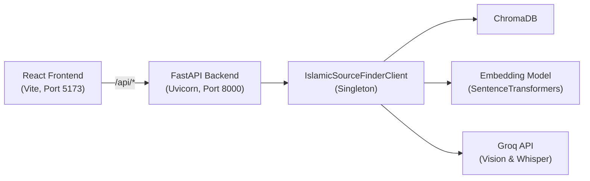

# Islamic Source Finder (ISF) - Web Application Documentation

This document provides a comprehensive overview of the `web/` directory in the Islamic Source Finder project. This directory contains the decoupled, production-grade web application built to serve the ISF core engine.

## 1. Architecture Overview

The web application transitions the ISF project from a Streamlit prototype to a decoupled, scalable architecture consisting of a FastAPI backend and a React (Vite) frontend.



### Key Architectural Decisions

1.  **Decoupling:** Separating the frontend from the backend allows for independent scaling, better resource management (handling heavy ML models separately from UI rendering), and improved user experience (no UI freezing during long tasks).
2.  **Sys.Path Injection:** The backend integrates with the existing `client.py` by dynamically adding the parent ISF directory to `sys.path`. This ensures the core engine code remains completely untouched and serves as a single source of truth.
3.  **Server-Sent Events (SSE):** The video processing pipeline can take 30-60 seconds. Standard HTTP requests would time out or leave the user waiting blindly. SSE provides real-time progress streaming to the frontend.
4.  **Singleton Pattern Integration:** The FastAPI dependency injection system ensures that only one instance of `IslamicSourceFinderClient` is created and shared across all API requests, preventing memory leaks from multiple model loads.

---

## 2. Directory Structure

```text
web/
├── backend/                  # FastAPI Application
│   ├── dependencies.py       # Dependency injection & client initialization
│   ├── main.py               # Application entry point, middleware, routing
│   ├── requirements.txt      # Backend-specific dependencies
│   ├── schemas.py            # Pydantic models for request/response validation
│   └── routes/               # API endpoint definitions
│       ├── __init__.py
│       ├── search.py         # Endpoints for text, image, and video queries
│       └── status.py         # Endpoint for system health and stats
│
└── frontend/                 # React Application (Vite)
    ├── index.html            # Entry HTML file with SEO metadata
    ├── package.json          # Node dependencies and scripts
    ├── vite.config.js        # Vite configuration (includes API proxy)
    ├── public/               
    │   └── favicon.svg       # Custom Islamic geometric motif favicon
    └── src/
        ├── App.jsx           # Root React component and state orchestrator
        ├── main.jsx          # React entry point
        ├── index.css         # Core design system and CSS variables
        ├── components/       # Reusable UI components
        │   ├── Footer.jsx
        │   ├── Library.jsx
        │   ├── Masthead.jsx
        │   ├── Ornaments.jsx
        │   ├── ProgressTracker.jsx
        │   ├── ResultCard.jsx
        │   ├── ResultsFeed.jsx
        │   ├── SearchInterface.jsx
        │   └── StarMark.jsx
        └── utils/
            ├── api.js        # API interaction service
            ├── constants.js  # Configuration constants (URLs, thresholds, video steps)
            └── sources.js    # Citations, passage cleanup and shared-word marking
```

---

## 3. Backend Details (`web/backend/`)

The backend is built with **FastAPI** to provide a high-performance, asynchronous REST API over the core ISF functionality.

### 3.1. `dependencies.py`
*   **Purpose:** Bridges the FastAPI app with the parent directory's `client.py`.
*   **Mechanism:** It modifies `sys.path` to include the ISF root directory, imports `IslamicSourceFinderClient`, and manages a module-level singleton instance of it. It also handles warming up the embedding model during application startup.

### 3.2. `schemas.py`
*   **Purpose:** Defines data structures and validation rules using **Pydantic**.
*   **Mechanism:** Ensures incoming requests are well-formed (e.g., sanitizing text queries, validating YouTube URLs via regex) and structures the outgoing JSON responses consistently.

### 3.3. `main.py`
*   **Purpose:** The core FastAPI application setup.
*   **Features:**
    *   **Lifespan Management:** Uses `@asynccontextmanager` to initialize the client and warm up models before accepting requests.
    *   **CORS:** Configured to allow cross-origin requests from the React development server (`localhost:5173`).
    *   **Rate Limiting:** Implements a custom middleware `RateLimiter` to restrict IP addresses to 30 requests per minute, preventing abuse of the public-facing tool.

### 3.4. `routes/search.py`
*   **Purpose:** Handles the core business logic for semantic search.
*   **Endpoints:**
    *   `POST /api/search/text`: Direct semantic search using the query string.
    *   `POST /api/search/image`: Accepts an image upload, sends it to Gemini to extract the text (especially Urdu) and translate it to English, then searches with the translation. Returns `extracted_urdu`, `extracted_query` and `results`.
    *   `POST /api/search/video`: Accepts a YouTube URL and returns a `StreamingResponse` (Server-Sent Events). It sends `progress` events numbered 1 to 4 (download the audio, upload it to Gemini, transcribe and translate, search), a `transcription` event, then `results`. Failures arrive as an `error` event with a `detail` field.

### 3.5. `routes/status.py`
*   `GET /api/status`: Returns the passage count, the indexed PDF names in `sources`, and the passages per PDF in `source_counts`. The counts are computed once and cached.

---

## 4. Frontend Details (`web/frontend/`)

The frontend is a Single Page Application (SPA) built with **React** and bundled using **Vite**.

### 4.1. Design System (`src/index.css`)
*   **Aesthetic:** Taken from printed hadith collections. The masthead is a green cloth cover with a gilt-tooled frame, and results open as a two-page spread.
*   **Color Palette:** Binding green (`#1D4436`), gilt (`#CFAA55`), page white (`#FBFBF8`) and ink (`#1E2622`), with a matching dark theme under `prefers-color-scheme: dark`.
*   **Typography:** *Literata* for passages and headings, *Atkinson Hyperlegible Next* for the interface, and *Noto Nastaliq Urdu* for Urdu read from screenshots. Fonts load from `index.html`.
*   **Motion:** One load animation (the gilt ornaments draw in). `prefers-reduced-motion` turns it off.

### 4.2. Core Components
*   **`App.jsx`**: Holds the search state, cancels in-flight searches with an `AbortController`, and keeps text searches in the address bar as `?q=` so a check can be shared as a link.
*   **`Masthead.jsx` & `Ornaments.jsx`**: The cover, with the server status, the live passage count and the search form.
*   **`SearchInterface.jsx`**: Text, Screenshot and YouTube link modes. Screenshots can be dropped, chosen or pasted from the clipboard. Includes example searches.
*   **`ProgressTracker.jsx`**: The four video pipeline steps with elapsed time and the transcript once it arrives.
*   **`ResultsFeed.jsx` & `ResultCard.jsx`**: A one-line verdict based on the best score, the best match as an open book beside the searched text, and the other passages below. Words shared between the search and a passage are marked.
*   **`Library.jsx`**: A shelf of the indexed books, each spine as wide as its passage count from `/api/status`.

### 4.2.1. Relevance thresholds (`src/utils/constants.js`)
Scores are cosine similarity. Sample queries against the current index put verbatim hadith at about 0.6 to 0.7 and same-topic passages at 0.45 to 0.6, so results are labelled "Close wording" from 0.60 and "Same subject" from 0.45.

### 4.3. API Integration (`src/utils/api.js`)
*   **Purpose:** Encapsulates all `fetch` calls to the backend.
*   **SSE Handling:** The `searchVideo` function implements a custom streaming parser to read the `TextDecoder` stream, parse the `event: ` and `data: ` blocks of the Server-Sent Events, and invoke callbacks (`onProgress`, `onTranscription`) to update the UI in real-time.

---

## 5. Development and Running

To run the full stack locally:

1.  **Start the Backend:**
    ```bash
    cd /path/to/ISF/web/backend
    uv run uvicorn main:app --reload --port 8000
    ```
2.  **Start the Frontend:**
    ```bash
    cd /path/to/ISF/web/frontend
    npm run dev
    ```
    *The Vite development server is configured (via `vite.config.js`) to proxy all requests starting with `/api` to `http://localhost:8000`.*
